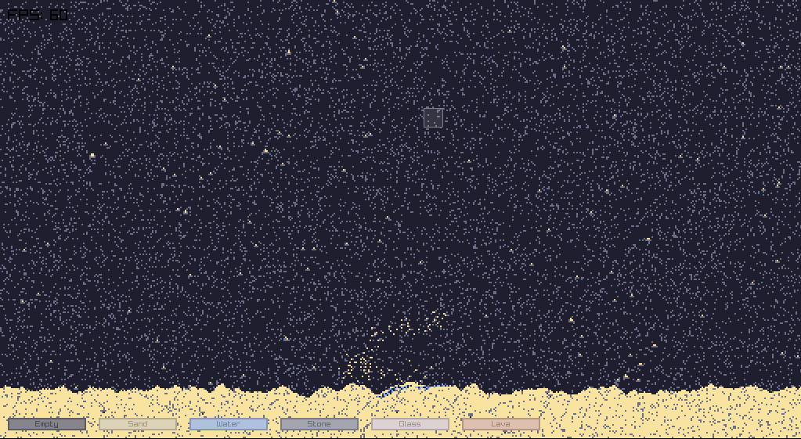

# Sand Simulator



## Running

``` bash
cmake --preset release
./build/app
```

## Project Structure

```
App
├── CMakeLists.txt
└── src
    ├── gui/
    ├── main.c
    ├── render           # Render game objects
    │   └── sim/
    ├── scenes/
    ├── scenes_id.h
    ├── simulation
    │   ├── elements/
    └── utils
```

## Cool resources

[Dwarf Fortress creator's take on Cellular Automata simulators](https://tomforsyth1000.github.io/papers/cellular_automata_for_physical_modelling.html)
[Simple fluid simulator](https://w-shadow.com/blog/2009/09/01/simple-fluid-simulation/)

